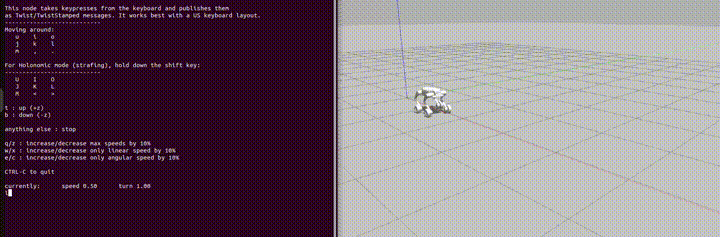

cd ~/dog_ws/src/zsl1w_description
mkdir -p docs
cat > README.md << 'EOF'
# ZSL-1W Wheel-Legged Robot — ROS 2 Gazebo Simulation



Simulation of the **GENISOM ZSL-1W** wheel-legged quadruped in **ROS 2 Humble** and **Gazebo Classic**,
as the mobile base for an autonomous mobile-manipulation project (ZSL-1W + AgileX Piper arm).

## Features
- ROS 2 description package built from the manufacturer's URDF (meshes, inertias, 16 joints)
- **Legs (12 joints):** torque-controlled PD via `joint_trajectory_controller` (effort interface),
  smooth stand-up into a computed standing pose
- **Wheels (4 joints):** skid-steer driving via `diff_drive_controller`, publishes odometry and TF
- Keyboard teleoperation with `teleop_twist_keyboard`
- Self-contained Gazebo world (no online model database needed)

## System
| Component | Version |
|---|---|
| OS | Ubuntu 22.04 |
| ROS 2 | Humble |
| Simulator | Gazebo Classic 11 |
| Control | ros2_control, gazebo_ros2_control |

## Installation
```bash
sudo apt install -y ros-humble-gazebo-ros-pkgs ros-humble-gazebo-ros2-control \
  ros-humble-ros2-control ros-humble-ros2-controllers ros-humble-joint-trajectory-controller \
  ros-humble-teleop-twist-keyboard ros-humble-xacro

mkdir -p ~/dog_ws/src && cd ~/dog_ws/src
git clone https://github.com/Priya-gilari/GenisomAI-mobile-manipulation.git zsl1w_description
cd ~/dog_ws
colcon build --packages-select zsl1w_description
source install/setup.bash
```

## Usage
**Start the simulation**
```bash
ros2 launch zsl1w_description gazebo.launch.py
```
**Drive with the keyboard** (second terminal)
```bash
ros2 run teleop_twist_keyboard teleop_twist_keyboard \
  --ros-args -r cmd_vel:=/diff_drive_controller/cmd_vel_unstamped
```
`i` forward · `,` backward · `j`/`l` turn · `k` stop · `q`/`z` speed up/down

**Check the controllers**
```bash
ros2 control list_controllers
```

## Robot parameters
| Parameter | Value |
|---|---|
| Total mass | 20.6 kg |
| Wheel radius | 0.0704 m |
| Wheel separation (left–right) | 0.319 m |
| Wheelbase (front–rear) | 0.349 m |
| Thigh / calf length | 0.200 m / 0.214 m |
| Standing pose (ABAD, HIP, KNEE) | 0.0, 0.8, −1.6 rad |
| Motor limits | 28 Nm, 28 rad/s |

## Package structure
